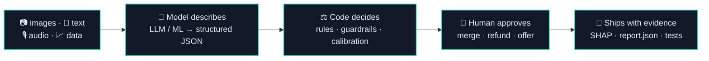

<div align="center">



<a href="https://www.linkedin.com/in/shiva-preetham-c-0124a2318/"></a>
<a href="mailto:shivapreetham079@gmail.com"></a>
<a href="https://dev.to/shiva_preetham"></a>
<a href="https://market-lens-nu.vercel.app"></a>


</div>

## 👋 Hey, I'm Shiva

I'm a CSE undergrad at **JIIT Noida** who builds AI systems you can actually trust: models that explain their predictions, LLM pipelines with guardrails written in code, and agents that ask a human before doing anything that matters. I like taking a project all the way from notebook to a deployed, tested app.

```python
class ShivaPreetham:
    education  = "B.Tech CSE @ Jaypee Institute of Information Technology, Noida (2024-28)"
    focus      = ["explainable ML", "multimodal LLM pipelines", "agentic workflows", "full-stack AI apps"]
    principle  = "Models gather evidence. Code makes the call. Humans approve."
    building   = ["ChurnSense (Agile PBL)", "MalariaVision (Image Processing & CV PBL)"]
    practising = "DSA in C++ on NeetCode / LeetCode (200+ solved)"
    fun_fact   = "Scored 100% in PCM in Class XII"
```

<details>
<summary><b>🧭 How I build AI systems</b> (the pattern behind most of my repos)</summary>
<br/>



You'll see it in **SaveFlow** (the LLM can only pick from offers the code allows), **ChronoTrace** (verdicts come from fixed rules, never a model's confidence), the **Claim Verifier** (a calibration layer over Gemini output) and **Support-to-Ship** (merges and refunds wait for a person).

</details>

<br/>



## 🚀 Featured projects

<table>
<tr>
<td width="50%" valign="top">
<a href="https://churnsense-one.vercel.app"></a>
<p>Upload customers, get an XGBoost churn score, the SHAP reasons behind it, and a <b>Next-Best-Action</b> engine that re-scores every retention move to find the one that helps most. Built in Agile sprints with tests written first.</p>
<p><code>FastAPI</code> <code>React + TS</code> <code>XGBoost</code> <code>SHAP</code> <code>GitHub Actions</code></p>
<p>🌐 <a href="https://churnsense-one.vercel.app"><b>Live demo</b></a> · 💻 <a href="https://github.com/Shiva-Preetham/Agile-PBL">Code</a></p>
</td>
<td width="50%" valign="top">
<a href="https://malariavision.vercel.app"></a>
<p>Cleans a blood-smear cell image with classical image processing, points to the stained parasite (Otsu, morphology, contours), then classifies it with a fine-tuned <b>MobileNetV2</b> served through ONNX Runtime.</p>
<p><code>OpenCV</code> <code>PyTorch</code> <code>ONNX</code> <code>FastAPI</code> <code>React 19</code></p>
<p>🌐 <a href="https://malariavision.vercel.app"><b>Live demo</b></a> · 💻 <a href="https://github.com/Shiva-Preetham/Image-Processing-CV-PBL">Code</a></p>
</td>
</tr>
<tr>
<td width="50%" valign="top">
<a href="https://github.com/Shiva-Preetham/hackerrank-orchestrate-june26-multimodal-evidence-review"></a>
<p>Verifies damage claims for cars, laptops and packages: per-image vision analysis, then claim synthesis, then deterministic business rules. Handles prompt injection hidden in photos, rate limits and model fallback. <b>Ranked 227 / 1,773.</b></p>
<p><code>Gemini 3.1 Flash-Lite</code> <code>Python</code> <code>Vision</code> <code>Structured JSON</code></p>
<p>💻 <a href="https://github.com/Shiva-Preetham/hackerrank-orchestrate-june26-multimodal-evidence-review">Code</a></p>
</td>
<td width="50%" valign="top">
<a href="https://market-lens-nu.vercel.app"></a>
<p>Per-stock Random Forest + XGBoost ensembles predict 5-day direction for NSE/BSE equities, with plain-English SHAP drivers, VADER news sentiment, efficient-frontier portfolios and <b>Claude Vision</b> import from broker screenshots.</p>
<p><code>FastAPI</code> <code>SQLAlchemy</code> <code>XGBoost</code> <code>SHAP</code> <code>Chart.js</code></p>
<p>🌐 <a href="https://market-lens-nu.vercel.app"><b>Live demo</b></a> · 💻 <a href="https://github.com/Shiva-Preetham/MarketLens">Code</a></p>
</td>
</tr>
<tr>
<td width="50%" valign="top">
<a href="https://youtu.be/_eDtsG07IjE"></a>
<p>Reads a cancelling subscriber's reason (any language) and PayPal history, then makes the best offer the merchant's plain-English policy allows and executes it through real PayPal APIs. Tested on a 50-case eval including prompt-injection attacks.</p>
<p><code>Gemini</code> <code>PayPal API</code> <code>AG Grid</code> <code>Python</code></p>
<p>🎥 <a href="https://youtu.be/_eDtsG07IjE"><b>Demo video</b></a> · 🌐 <a href="https://saveflow-ufbx.onrender.com">Live</a> · 💻 <a href="https://github.com/Shiva-Preetham/SaveFlow-PayPal-AI-Hackathon">Code</a></p>
</td>
<td width="50%" valign="top">
<a href="https://youtu.be/mUrFossp2F4"></a>
<p>Support, fixer and reviewer agents share team chat on Switch: the fixer writes a failing regression test first, the reviewer checks the diff, and the merge and the customer reply both wait for a human.</p>
<p><code>Claude Code</code> <code>Switch</code> <code>JavaScript</code> <code>Multi-agent</code></p>
<p>🎥 <a href="https://youtu.be/mUrFossp2F4"><b>Demo video</b></a> · ✍️ <a href="https://dev.to/shiva_preetham/i-built-a-support-to-engineering-pipeline-with-3-ai-agents-and-2-human-approvals-on-switch-4hk0">Blog post</a> · 💻 <a href="https://github.com/Shiva-Preetham/Flip-the-Switch-Hackathon">Code</a></p>
</td>
</tr>
</table>

<details>
<summary><b>🧪 More builds</b> (fraud detection, video forensics, data platforms...)</summary>
<br/>

| Project | What it does | Stack |
|---|---|---|
| 🎥 [**ChronoTrace**](https://github.com/Shiva-Preetham/ChronoTrace) | Catches return-swap fraud by comparing the seller's packing video with the return-unboxing video: SAM 3.1 tracking, QR identity and Muse Spark, with verdicts from fixed rules and SHA-256 evidence. *Meta Global AI Developer Hackathon* | Python · SAM 3.1 · OpenCV |
| 📣 [**Signal**](https://github.com/Shiva-Preetham/Meta-Hackathon) | Turns scattered customer feedback into a revenue-ranked list of what to fix next, with the verbatim quotes behind every theme. *Meta Global AI Developer Hackathon* | Python · Muse Spark |
| 🏢 [**Enterprise AI Decision Intelligence**](https://github.com/Shiva-Preetham/Enterprise-AI-Decision-Intelligence-Platform) · [live](https://enterprise-ai-decision-intelligence.vercel.app) | RFM segments, lifetime value, churn with SHAP, next-best-action and a LangGraph + RAG business assistant. | FastAPI · XGBoost · LangChain · React · Docker |
| 💳 [**Real-Time Fraud Detection**](https://github.com/Shiva-Preetham/Fraud-Detection-System) | Kafka stream → Spark Structured Streaming → XGBoost + Isolation Forest scoring, bronze/silver/gold lake on S3, Athena SQL and a live ops dashboard. | Kafka · Spark · AWS · FastAPI |
| 📉 [**Spend Intelligence**](https://github.com/Shiva-Preetham/Spend-Intelligence-Anomaly-Detection-System) | Detects spend anomalies with a PyTorch autoencoder, diagnoses the segment behind them (KMeans + XGBoost + SHAP) and writes the business narrative. | PyTorch · DuckDB · MLflow |
| 🔔 [**Message Notification Router**](https://github.com/Shiva-Preetham/Message-Notification-Router) | Text, OCR and Whisper transcripts go through a hardened describer, then a pure rule engine decides scam and notification overrides. Crash-safe checkpoints. *HackerRank Orchestrate, Aug 2026* | Python · Whisper |
| 🛡️ [**Adamantium**](https://github.com/Shiva-Preetham/Adamantium) · [live](https://adamantium-beta.vercel.app) | Interview-prep platform: CN, OS, DBMS, HLD/LLD and system-design notes with MCQ practice. | TypeScript · Docker |
| 🧩 [**NeetCode submissions**](https://github.com/Shiva-Preetham/neetcode-submissions) | My daily DSA practice. | C++ |

</details>

## 🛠️ Tech stack

<p align="center">
  
</p>

<p align="center">
  
  
  
  
  
  
  
  <br/>
  
  
  
  
  
  
  
</p>

<p align="center"><b>Core CS</b>: Data Structures & Algorithms · DBMS · OOP · Operating Systems · Computer Networks</p>

## 🏁 Hackathon log

| Event | What I built |
|---|---|
| 🎯 **HackerRank Orchestrate** (Jun 2026) · rank **227 / 1,773**, top 13% | [Multi-Modal Claim Evidence Verifier](https://github.com/Shiva-Preetham/hackerrank-orchestrate-june26-multimodal-evidence-review) |
| ⚡ **HackerRank Orchestrate** (Aug 2026) | [Message Notification Router](https://github.com/Shiva-Preetham/Message-Notification-Router) |
| 🌐 **Meta Global AI Developer Hackathon**, indie track | [ChronoTrace](https://github.com/Shiva-Preetham/ChronoTrace) · [Signal](https://github.com/Shiva-Preetham/Meta-Hackathon) |
| 💳 **PayPal AI Hackathon** | [SaveFlow](https://github.com/Shiva-Preetham/SaveFlow-PayPal-AI-Hackathon) |
| 🔀 **Flip the Switch** (WeMakeDevs × DevTools Academy × Switch) | [Support-to-Ship Bridge](https://github.com/Shiva-Preetham/Flip-the-Switch-Hackathon) |

## 📜 Certifications

- 🎓 [**Machine Learning Specialization**](https://coursera.org/share/645949bed35b3b91e69e4c4dfd70f901): Stanford Online / Coursera
- 📈 [**Financial Markets (Honors)**](https://coursera.org/share/1d980330fdf825e4551cf43a25d0ff5e): Yale University / Coursera
- 🏅 **NPTEL Scalable Data Science** (Elite): IIT Kharagpur
- 🏅 **NPTEL Solid State Physics** (Elite + Silver, top 5%): IIT Kharagpur

## ✍️ Writing

- [I Built a Support-to-Engineering Pipeline with 3 AI Agents and 2 Human Approvals on Switch](https://dev.to/shiva_preetham/i-built-a-support-to-engineering-pipeline-with-3-ai-agents-and-2-human-approvals-on-switch-4hk0) on dev.to

## 📊 GitHub activity

<p align="center">
  
</p>

<p align="center">
  <picture>
    <source media="(prefers-color-scheme: dark)" srcset="https://raw.githubusercontent.com/Shiva-Preetham/Shiva-Preetham/output/snake-dark.svg" />
    
  </picture>
</p>


